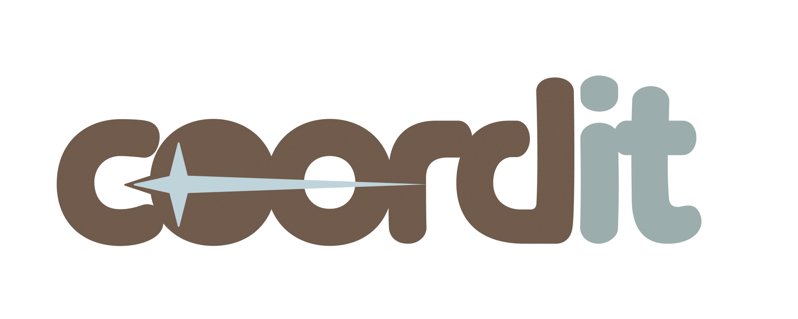
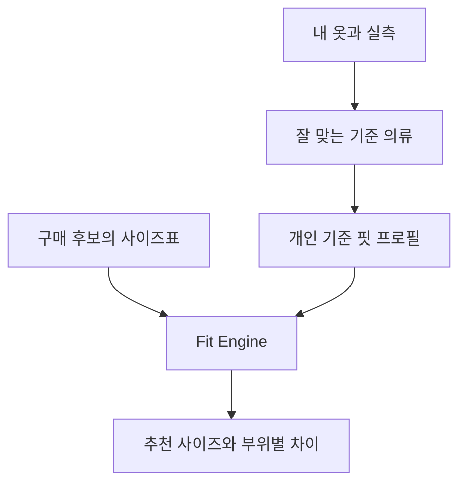
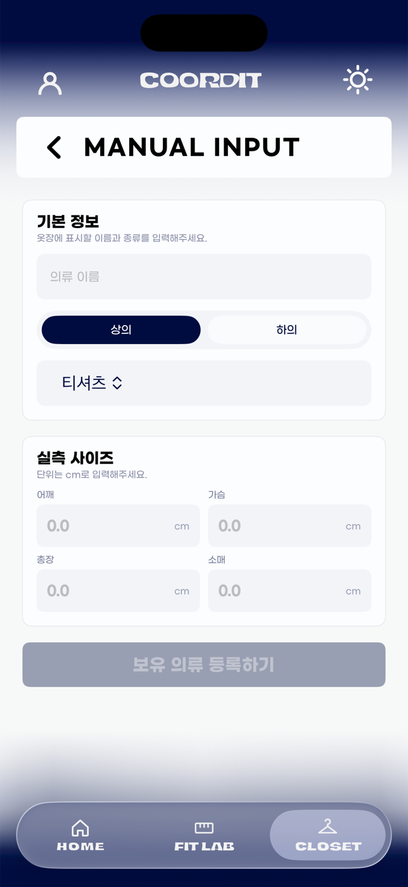
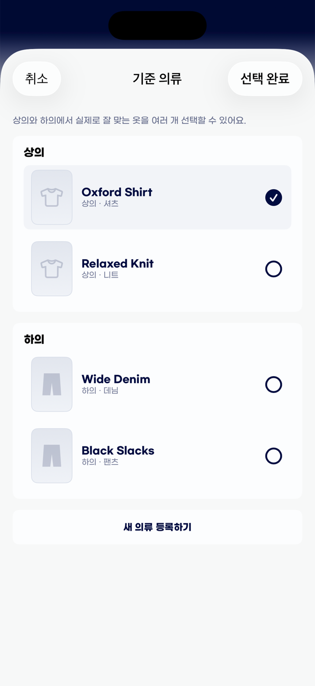
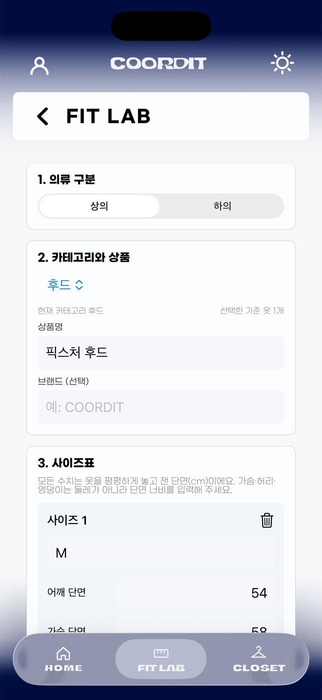
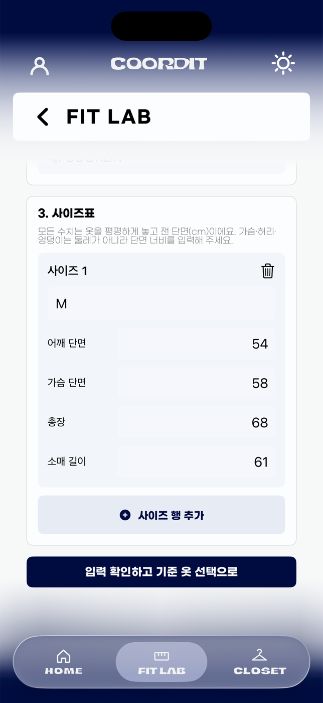
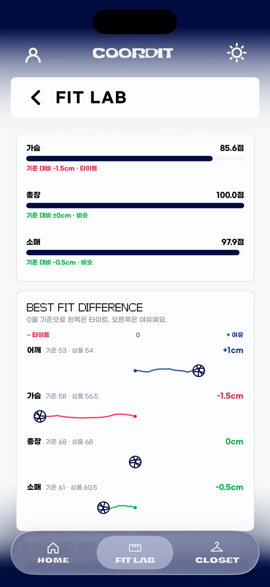
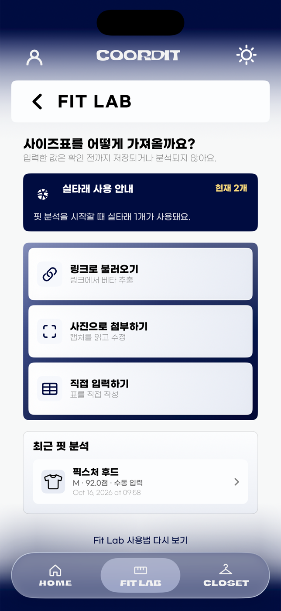
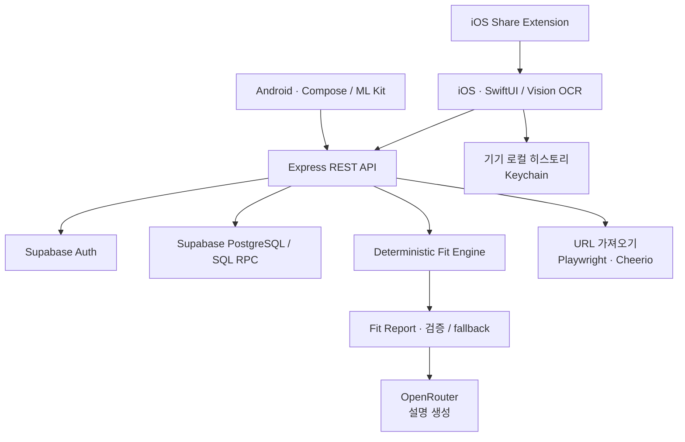

<div align="center">



# coordit

**Your clothes already know your fit.**

잘 맞는 옷 한 벌이, 다음 쇼핑의 기준이 됩니다.

브랜드마다 다른 M 사이즈를 추측하는 대신,<br>
**내가 잘 입는 옷의 실측과 구매할 상품의 사이즈표를 비교하세요.**<br>
coordit은 가장 가까운 사이즈와 부위별 차이를 함께 보여줍니다.

**iOS · SwiftUI** &nbsp; / &nbsp; **Android · Jetpack Compose** &nbsp; / &nbsp; **Measurement-based Fit**


&nbsp;


<sub>현재 SwiftUI 앱을 iPhone 17 Pro 시뮬레이터에서 직접 캡처했습니다.<br>기존 DEBUG 데모 데이터이며, 점수는 실제 사용자의 결과나 정확도 지표가 아닙니다.</sub>

[사용 흐름](#how-it-works) · [Fit Engine](#fit-score-engine) · [Architecture](#architecture) · [로컬 실행](#getting-started) · [구현 상태](#project-status)

</div>

## 같은 M이어도, 같은 핏은 아니니까

브랜드의 사이즈 이름만으로는 어깨가 얼마나 내려오는지, 가슴에 얼마나 여유가 생기는지 알기 어렵습니다. 모델의 착용 사진이나 키·몸무게도 내가 좋아하는 핏을 모두 설명해 주지는 못합니다.

coordit의 출발점은 **이미 입어 보고 잘 맞는다고 느낀 옷**입니다. 그 옷의 실측을 개인 기준으로 삼고, 구매 후보의 각 사이즈가 어디에서 얼마나 달라지는지 비교합니다.

| 쇼핑할 때의 질문 | coordit에서 확인하는 것 |
| --- | --- |
| 이 브랜드도 M을 사면 될까? | S/M/L 이름 대신 사이즈별 실제 의류 치수 |
| 넉넉한 건 좋은데, 소매도 길어질까? | 어깨·가슴·총장·소매 등 부위별 cm 차이 |
| 추천 사이즈가 다른 사이즈보다 나은 이유는? | 모든 후보의 점수와 추천·대안 사이즈의 차이 |



## How it works

coordit의 제품 플랫폼은 **iOS와 Android**입니다. 아래 화면은 iOS 앱의 **Closet → Fit Lab 흐름**을 보여줍니다. Android도 옷장·기준 의류·핏 분석·히스토리를 구현하고 있으며, 플랫폼별 지원 범위는 [구현 상태](#project-status)에 정리했습니다.

iOS 첫 실행에서는 시작 화면과 로그인/회원가입 진입 버튼을 만납니다. Google·Apple 계정 연결, 비회원 시작, 이메일 로그인이 구현되어 있으며, 새 사용자는 프로필·선택적 키/몸무게·약관 동의 온보딩을 거칩니다.

### 01. 잘 입는 옷부터 등록하세요

Closet에서 보유 의류를 검색하고 종류별로 관리합니다. 등록은 **상품 링크, 사이즈표 사진, 직접 입력** 중 선택합니다. 링크나 사진에서 읽은 사이즈표도 확인하고 내가 가진 사이즈를 골라 저장합니다.

직접 입력에서는 의류 이름과 카테고리, cm 단위 실측을 기록합니다. 가슴·허리·엉덩이는 **둘레가 아닌 단면 너비**입니다. 의류 사진은 등록 후 상세 화면에서 추가할 수 있습니다.

<p align="center">
  
</p>

### 02. 나의 기준이 될 옷을 고르세요

Home의 **옷장에서 선택**에서 잘 맞는 옷을 기준 의류로 지정합니다. 여러 벌을 선택할 수 있고, Fit Lab에서도 기준 의류를 선택하거나 등록할 수 있습니다. 분석할 때는 구매 후보와 호환되는 카테고리의 기준 옷을 사용합니다.

<p align="center">
  
</p>

### 03. 구매 후보의 사이즈표를 가져오세요

Fit Lab에서 상품 링크를 붙이거나 사이즈표 사진을 읽고, 필요하면 직접 수정합니다. 수동 입력에서는 상품명·카테고리와 사이즈별 실측 행을 작성합니다. iOS 공유 확장으로 외부 앱의 상품 링크를 넘길 수도 있습니다.

**입력 확인 → 기준 옷 선택 → 핏 분석 시작** 순서로 진행합니다. URL 가져오기는 베타 기능으로, 읽을 수 없는 상품은 사진 또는 직접 입력으로 이어갑니다.

<p align="center">
  
  &nbsp;
  
</p>

### 04. 점수와 함께, 차이를 읽으세요

결과는 추천 사이즈 하나로 끝나지 않습니다. **사이즈별 점수, 마네킹 위의 실측 차이, 부위별 유사도, 실루엣·활동성·레이어링 점수**를 볼 수 있습니다. 상세 리포트는 추천 이유와 대안 사이즈의 장단점을 설명합니다.

차이의 부호는 `상품 − 기준 의류`입니다. 음수는 더 작고, 양수는 더 큽니다. 색과 함께 수치·텍스트를 표시하므로 “점수가 높다”와 “더 여유롭다”를 구분할 수 있습니다.

<p align="center">
  
  &nbsp;
  
</p>

### 05. 다시 볼 결과는 히스토리에 남기세요

리포트의 **히스토리에 추가**를 누르면 전체 결과 스냅샷을 저장합니다. **확인하기**는 저장 없이 Fit Lab으로 돌아갑니다. 저장한 리포트는 Fit Lab과 Home에서 다시 열 수 있습니다.

iOS 히스토리는 사용자별로 분리된 **기기 로컬 파일**입니다. 서버의 분석 기록과 별개이며, 기기 간 히스토리 동기화 기능으로 소개하지 않습니다. 분석 중 다른 탭으로 이동해도 작업은 이어지고 완료 알림에서 결과로 돌아갈 수 있습니다.

<p align="center">
  
</p>

## Fit Score Engine

현재 추천 엔진은 **`fit_engine_v2_0` 규칙 기반 엔진**입니다. 점수와 추천 사이즈는 코드가 계산하고, OpenRouter는 계산된 결과를 설명하는 리포트 문장을 생성합니다. LLM이 추천 점수를 결정하지 않습니다.

### 무엇을 비교하나요?

11개 카테고리는 각각 가중치와 허용 오차를 갖습니다. 아래는 **서버 엔진**이 사용하는 측정 항목입니다.

| 카테고리 | 비교하는 실측 | 기본 가중치 예시 |
| --- | --- | --- |
| 티셔츠·셔츠·스웨트셔츠·후드·니트·재킷·코트 | 어깨, 가슴단면, 총장, 소매 | 티셔츠: 가슴 38%, 총장 30%, 어깨 20%, 소매 12% |
| 팬츠·데님 | 허리단면, 엉덩이단면, 밑위, 아웃심 | 팬츠: 허리 34%, 엉덩이 28%, 밑위 18%, 아웃심 20% |
| 반바지·스커트 | 허리단면, 엉덩이단면, 총장 | 스커트: 허리 42%, 엉덩이 33%, 총장 25% |

### 어떻게 추천하나요?

1. **기준 옷을 고릅니다.** 같은 카테고리가 있으면 우선 사용하고, 없으면 명시된 관련 카테고리만 허용합니다. 호환되는 기준 옷이 없으면 요청을 거절합니다.
2. **여러 벌을 하나의 프로필로 만듭니다.** 선호도 가중 중앙값과 Huber 보정 평균으로 특이값의 영향을 줄입니다. 기준 옷들 사이에서 편차가 작은 부위는 더 높은 가중치를 받습니다.
3. **차이를 허용 오차로 나눕니다.** 부위·카테고리·작거나 큰 방향·핏 타입에 따라 허용 오차가 달라집니다. 없는 치수는 0으로 채우지 않고 비교에서 제외하며, 남은 가중치 합으로 정규화합니다. 비교할 항목이 전혀 없으면 계산하지 않습니다.
4. **정규화한 손실을 점수로 바꿉니다.** 작은 차이에는 제곱 손실, 큰 차이에는 선형 손실을 적용합니다. 어깨와 가슴처럼 함께 봐야 하는 부위의 불균형에는 최대 2점의 추가 감점이 있습니다.
5. **최종 점수가 가장 높은 사이즈를 선택합니다.** 모든 후보 점수와 부위별 차이, 대안 사이즈 비교를 함께 반환합니다.

```text
zᵢ = |상품 실측ᵢ − 기준 프로필ᵢ| / 유효 허용 오차ᵢ
Huber(z) = z² / 2  (z ≤ 1),  z − 0.5  (z > 1)
L = Σ(유효 가중치ᵢ × Huber(zᵢ)) / Σ(유효 가중치ᵢ)
Fit Score = max(0.1, round(100 × exp(−L / 1.5), 2) − 부위 조합 감점)
```

화면은 0–100 척도를 사용하지만 엔진의 실제 하한은 **0.1점**입니다. 점수는 기준 의류와의 적합도를 나타내며, 구매 성공 확률이나 검증된 예측 정확도가 아닙니다.

`slim / regular / relaxed / oversized`는 허용 오차와 중요 부위의 가중치를 바꿉니다. 예를 들어 oversized는 어깨·가슴이 더 큰 경우를 regular보다 넓게 허용합니다. **현재 iOS의 상품·기준 의류 생성은 `regular`를 전송**하며, 네 가지 핏 타입은 엔진/API의 지원 범위입니다.

구매 후 피드백 저장 API와 제한적 개인화 보정도 구현되어 있습니다. 해당 카테고리의 유효 신호가 5건 이상이고 방향이 충돌하지 않는 등 적용 조건을 만족할 때만 보정합니다. 치수 이동은 ±2cm, 가중치 배수는 최대 1.3으로 제한합니다. **현재 iOS에 구매 후 피드백 입력 화면은 연결되어 있지 않습니다.**

[엔진 코드](backend/src/modules/fit/fit-score.engine.ts) · [V2 점수 계산](backend/src/modules/fit/fit-score.v2.ts) · [카테고리 프로필](backend/src/modules/fit/garment-fit-profiles.ts) · [알고리즘 상세](docs/fit-engine/FIT_ENGINE.md)

## Architecture



API는 Supabase로 Bearer 토큰을 검증하고 온보딩 상태를 확인합니다. 사용자 데이터 조회는 `user_id`로 제한하며 DB에는 소유자 기준 RLS 정책이 있습니다. 서버는 service-role 클라이언트를 사용하므로 **서버의 소유권 검사와 RLS를 함께 관리**합니다.

옷장과 실측의 동시 저장, 분석 저장, 실타래 차감에는 SQL RPC와 멱등성 키를 사용합니다. 기본 사이즈 추천과 상세 리포트는 별도 단계이며, 현재 상세 리포트 생성에는 **실타래 1개**가 사용됩니다. 리포트 생성 실패·응답 검증 실패 시에는 계산 결과 기반 fallback 설명을 반환하는 경로가 있습니다.

### Tech stack

| 영역 | 저장소의 구현 |
| --- | --- |
| iOS | Swift, SwiftUI, Vision OCR, PhotosUI, AuthenticationServices, Keychain, StoreKit, Share Extension |
| Android | Kotlin 2.0, Jetpack Compose, StateFlow, Retrofit, ML Kit OCR, Keystore |
| API | Node.js, Express 4, TypeScript, Zod, Supabase JS |
| Data / Auth | Supabase PostgreSQL, Auth, RLS, SQL functions |
| Fit / Report | 자체 규칙 엔진, OpenRouter, 검증된 결과 기반 fallback |
| URL import | Playwright Chromium, Cheerio, 도메인별 파서와 요청 제한 |
| 개발·배포 | npm lockfile, Xcode, Gradle, Docker, GitHub Actions; Cloud Run 배포 가이드 |

### Repository

```text
coordit-dev/
├── coordit/       # SwiftUI 앱, Xcode 프로젝트, 공유 확장, UI 테스트
├── android/       # Kotlin / Compose 앱과 포팅 검증 기록
├── backend/       # REST API, Fit Engine, 리포트, 테스트
├── supabase/      # 스키마, 인덱스, RLS, 기능별 마이그레이션
├── config/        # SimSlim 등 공통 개발 설정
├── tools/         # 독립 개발 도구와 과거 Fit Score playground
└── docs/          # 제품·API·배포 문서와 README 캡처
```

[문서 모음](docs/README.md) · [iOS 디자인 시스템](DESIGN.md) · [Android 안내](android/README.md) · [백엔드 안내](backend/README.md) · [개발 도구](tools/README.md)

`frontend/`는 내부 테스트용 웹이며 배포 대상이 아닙니다. README의 로고는 기존 `frontend/public/logo.png` 자산을 사용합니다. `.omo/`, `.worktrees/`, 의존성과 빌드 출력, `deliverables/`의 로컬 산출물은 위 제품 구조에서 제외했습니다.

## Getting started

**공통 API를 실행한 뒤 iOS 또는 Android 앱을 연결합니다.** API는 Node.js 22(CI 기준)와 npm, 실제 데이터 기능에는 별도의 개발용 Supabase 프로젝트가 필요합니다. iOS는 Xcode와 iOS 26.5 SDK·Simulator runtime, Android는 JDK 17 이상과 Android SDK 35를 준비합니다.

```bash
git clone https://github.com/ganadidududu/coordit.git coordit-dev
cd coordit-dev
npm --prefix backend ci

# 새 checkout에서만 복사. 기존 환경파일이 있으면 필요한 항목을 병합하세요.
cp backend/.env.example backend/.env
```

환경값을 설정하고 [개발 DB 준비 순서](docs/README_DEVELOPMENT.md#database)를 적용한 뒤, 저장소 루트에서 API를 실행합니다.

```bash
# http://localhost:4000
cd backend
npm run dev
```

API 기본 동작은 `curl http://localhost:4000/health`로 확인합니다. `/health` 성공은 DB 연결이나 소셜 로그인 검증을 의미하지 않습니다.

### Environment

| 위치 | 변수 | 용도 |
| --- | --- | --- |
| Backend · 필수 | `SUPABASE_URL`, `SUPABASE_ANON_KEY`, `SUPABASE_SERVICE_ROLE_KEY` | Auth와 서버 데이터 접근 |
| Backend | `PORT`, `NODE_ENV`, `CORS_ORIGINS` | 기본 포트 4000. production에서는 정확한 HTTPS origin 목록 필수 |
| 상세 설명 생성 | `OPENROUTER_API_KEY`, `OPENROUTER_MODEL`, `OPENROUTER_TIMEOUT_MS` | 기본 모델 `google/gemini-2.5-flash`; 키가 없으면 fallback 경로 |
| 선택 기능 | `APPLE_DEVICECHECK_*`, `APPLE_IAP_*`, `ADMOB_*` | 비회원 환영 지급, 결제·광고 정산 |
| iOS build setting | `COORDIT_API_BASE_URL` | 개발 API 주소. 로컬 실행 시 명시적으로 덮어쓰기 |
| Android Gradle property | `COORDIT_API_BASE_URL`, `COORDIT_RELEASE_API_BASE_URL`, `GOOGLE_WEB_CLIENT_ID` | debug/release API 주소, Google 로그인 설정 |

서버 비밀값은 모바일 앱에 넣지 않습니다. 서버는 `backend/.env.example`을 기준으로 설정합니다. `JWT_SECRET`은 예제에 남아 있지만 현재 인증 미들웨어는 자체 JWT 검증 대신 Supabase `auth.getUser`를 호출합니다.

### iOS demo

Xcode 프로젝트는 `coordit/coordit.xcodeproj`, scheme은 `coordit`입니다. 현재 deployment target은 **iOS 26.5**입니다. 대응 SDK·Simulator runtime과 SimSlim이 필요합니다.

```bash
simslim list --json
SIM_UDID="선택한 시뮬레이터 UDID"
simslim on "$SIM_UDID" --profile config/simslim/coordit-dev.json
simslim verify "$SIM_UDID" --profile config/simslim/coordit-dev.json
simslim doctor "$SIM_UDID" --requires push,storekit,universal-links,keychain-sync,photos

xcodebuild -project coordit/coordit.xcodeproj -scheme coordit \
  -configuration Debug -destination "id=$SIM_UDID" \
  -derivedDataPath /tmp/coordit-readme-build \
  COORDIT_API_BASE_URL=http://127.0.0.1:4000 build

xcrun simctl install "$SIM_UDID" /tmp/coordit-readme-build/Build/Products/Debug-iphonesimulator/coordit.app
xcrun simctl launch "$SIM_UDID" com.inseong.coordit \
  --coordit-ui-testing --coordit-ui-testing-authenticated \
  --coordit-start-route fitlab-result-top --coordit-fitlab-fixture upper-result
```

마지막 실행은 **기존 DEBUG fixture로 실제 결과 UI를 확인하는 오프라인 데모**입니다. 실제 서버 연동은 테스트 인자를 제거하고 개발용 Auth·DB 설정을 사용합니다. 공유된 Xcode 설정에 staging 주소가 있으므로 로컬 빌드에서는 위 API override를 유지하세요.

### Android

Android Studio에서 `android/`를 열고 SDK 경로를 설정합니다. 에뮬레이터를 실행한 뒤 저장소 루트의 새 터미널에서 다음을 실행합니다. `10.0.2.2`는 Android Emulator에서 호스트 Mac의 로컬 API에 접근하는 주소입니다.

```bash
cd android
./gradlew :app:installDebug -PCOORDIT_API_BASE_URL=http://10.0.2.2:4000/
adb shell am start -n com.inseong.coordit.debug/com.inseong.coordit.MainActivity
```

Google 로그인에는 Android client·서명 등록이 필요합니다. release API는 HTTPS 주소를 별도로 설정합니다. 자세한 SDK·빌드·인증 설정은 [Android 안내](android/README.md)와 [Google 로그인 설정](android/docs/GOOGLE_SIGN_IN_SETUP.md)을 따릅니다.

### Checks

```bash
npm --prefix backend run typecheck
npm --prefix backend run test:fit
npm --prefix backend run test:report
```

전체 backend CI는 `npm test`, build, Docker build도 수행합니다. 이 README 작업에서 확인한 실행 결과와 검증 범위는 [캡처·검증 기록](docs/README_EVIDENCE.md)에 정리했습니다.

## Project status

**현재 코드에 구현된 범위**입니다. 스토어 출시 완료나 모든 외부 서비스의 운영 검증을 뜻하지 않습니다.

| 상태 | 기능과 범위 |
| --- | --- |
| 구현 | iOS 인증·온보딩, 옷장 등록·조회·삭제·실측, 기준 의류 선택, Fit Lab 수동 입력·OCR, 결과·기기 로컬 히스토리 |
| 구현 | Supabase 인증 검증, 소유자별 API, 다중 기준 의류 V2 엔진, 상세 리포트와 fallback, 분석 기록·피드백 API |
| 베타 | 상품 URL 가져오기. 상품 페이지 형식과 접근 가능 여부에 따라 결과가 달라지며 사용자 확인 필요 |
| 구현·설정 의존 | OpenRouter 리포트 문장 생성, 실타래 지갑, StoreKit·AdMob 정산. 기본 결제·광고 활성화 플래그는 false |
| 구현 · Android | Google 로그인·세션 복원, 온보딩, 옷장·기준 의류, 수동 입력·OCR·링크 추출, Fit Lab 추천·리포트·기기 로컬 히스토리 |
| 진행 중 · Android | 포팅 안정화, Apple 로그인·Google Play 결제·공유/딥링크 등 남은 플랫폼 연동 |
| 아직 제공하지 않음 | 학습된 ML 사이즈 예측, 브랜드별 실측 정규화, 기기 간 로컬 히스토리 동기화, iOS 구매 후 피드백 입력 UI |

현재 구현과 출시 조건은 [출시 준비 문서](docs/RELEASE_READINESS.md), [Android 진행 상태](android/docs/IMPLEMENTATION_STATUS.md), [운영 배포 문서](docs/DEPLOYMENT_PRODUCTION.md)를 함께 확인하세요.

## Roadmap

[기존 로드맵](docs/ROADMAP.md)과 [Hybrid Scoring 데이터 계약](docs/fit-engine/HYBRID_SCORING_READINESS.md)에 근거한 다음 단계입니다.

- OCR·URL 추출의 품질과 실패 복구 개선. 두 입력 방식 자체는 이미 구현되어 있습니다.
- 피드백 신호의 통계 품질 검증, 브랜드별 편차 보정과 개인별 선호 여유분 분석.
- 충분한 결과 데이터가 쌓인 뒤 hybrid scoring·신뢰도 보정 검토. 현재 export 계약은 준비되어 있으나 ML 학습·추론 서비스는 없습니다.
- 모바일 안정화와 Android의 남은 플랫폼 연동, 다양한 화면·글꼴·접근성 환경 검증.

---

**내 옷장에서 시작해서, 다음 옷의 사이즈까지.**

